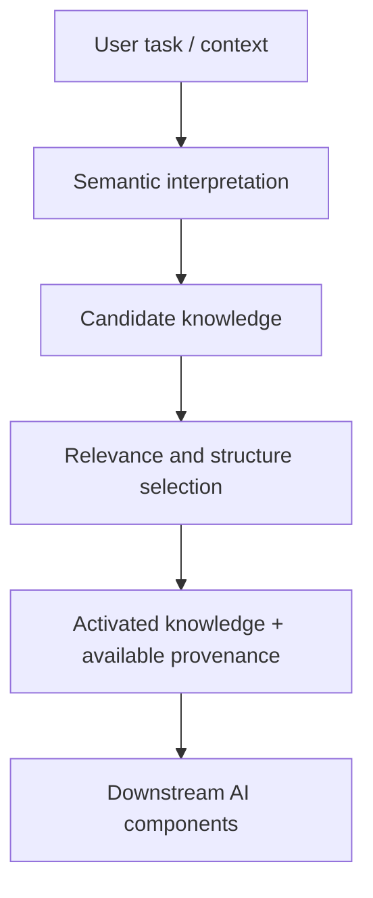

  

<h1 align="center">aXiom</h1>

  Concise related and structured knowledge activated by semantic meaning.

> 🚧 **Under Active Development**
>
> This module is currently under active development. Its architecture, features, and documentation are evolving and may change as research and implementation progress. **Not yet recommended for production use**.

## Overview

aXiom investigates how a language-model-based system can identify, organize, and activate **concise, contextually relevant, structured knowledge** in response to the meaning of a task. It is part of [The Glass Box AI Project](https://glassboxai.dev/) and the experimental NeXis architecture.

The research question is: **Can explicit, inspectable knowledge activation improve the relevance and traceability of information supplied to downstream AI components?**

## Architectural concept

Rather than treating all available knowledge as equally relevant, aXiom explores a distinct knowledge-activation stage:

1. Interpret the input task and identify its informational requirements.
2. Identify candidate knowledge elements related to the task's semantic meaning.
3. Organize and select a concise set of relevant knowledge elements, preserving available relationships and provenance.
4. Make the activated knowledge available to downstream reasoning or generation components.
5. Retain enough information about selection decisions to support inspection and evaluation.

This diagram describes the conceptual responsibilities, **not a verified implementation pipeline**. Data models, retrieval algorithms, activation policies, and interfaces will be documented when ready for release.

## Research objectives

- Represent and select task-relevant knowledge without unnecessarily expanding context.
- Explore explicit relations among activated knowledge elements.
- Improve inspectability of which information was selected and why.
- Study integration with language models and other neuro-symbolic components.
- Investigate how knowledge activation differs from, or complements, conventional retrieval-augmented generation (RAG).

## Relationship to RAG

Conventional RAG often retrieves text passages for inclusion in a model's context. aXiom investigates a broader **knowledge activation** problem, including the structure, relevance, and traceability of selected information. This distinction is a research objective, not a claim of superiority over RAG.

## Evaluation plan

Possible evaluation dimensions include retrieval/activation precision and recall, context efficiency, provenance coverage, downstream task accuracy, robustness to irrelevant knowledge, and latency. Comparisons should use well-defined RAG baselines and reproducible datasets.

**No comparative benchmark results are published here at present.**

## Relationship to NeXis

Within the experimental NeXis architecture, aXiom addresses knowledge activation, [veXtor](https://github.com/glassboxai/veXtor) explores semantic guidance during LLM decoding, and [fliXer](https://github.com/glassboxai/fliXer) explores logical validation. These are complementary research directions, not proof of an integrated, validated system.

## Availability and roadmap

The repository currently contains a public research overview. Potential future releases include architecture specifications, knowledge representations, a reproducible prototype, tests, and evaluation reports. No release schedule is guaranteed.

## Limitations

Activated knowledge may be incomplete, stale, inconsistent, or incorrectly ranked. Provenance does not itself guarantee factual correctness. The quality of downstream responses depends on the knowledge source, activation mechanism, and consuming model.

## Project

- [The Glass Box AI Project](https://glassboxai.dev/)
- [Glass Box AI on GitHub](https://github.com/glassboxai)

## License

This repository is licensed under **AGPL-3.0**. See [LICENSE](LICENSE). Any future source-code release will identify its applicable license and third-party dependencies.

